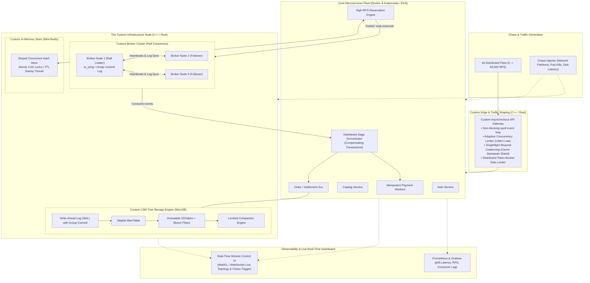

# Project Blueprint: TicketForge Chaos-Cloud
## The Ultimate FAANG-Grade Distributed Systems Showcase

---

## 1. The Resume "Wow Factor" Pitch
If you put this on your resume or show this in a Big Tech (L5/L6+) or Quant systems interview, interviewers will stop asking generic LeetCode questions and spend the entire interview discussing your architecture.

### What You Will Be Able to Put on Your Resume:
> * **Engineered a distributed, fault-tolerant event booking platform** evolving from a modular monolith to a microservices cluster, subsequently replacing off-the-shelf tools with **custom C++/Rust distributed primitives**.
> * **Implemented a custom distributed commit log broker** utilizing Linux `mmap`/`io_uring` zero-copy I/O and custom binary wire protocol, achieving sub-millisecond append latency under 50k RPS.
> * **Designed a custom Raft Consensus engine** supporting leader election, log replication, and heartbeat quorums to prevent split-brain during simulated network partitions.
> * **Engineered an in-memory storage engine** featuring striped concurrent hash tables, active/passive TTL eviction, and atomic Compare-And-Swap (CAS) flash-sale locks guaranteeing **zero overselling** under high contention.
> * **Authored a custom asynchronous API Gateway** featuring Netflix-style **Adaptive Concurrency Limiting** (Little's Law) and **Singleflight** cache stampede mitigation.
> * **Subjected the cluster to Jepsen-style Chaos Engineering**: Surviving 50,000 RPS burst spikes, simulated network partitions (`iptables`), 500ms disk latency injections, and simultaneous multi-pod terminations with zero data corruption.

---

## 2. The "Crazy" Architecture (High-Level Topology)



---

## 3. The 6 "Insane" Engineering Features Included

### 1. Raft Consensus Protocol (Mini-Kafka Cluster)
* **What it does**: Instead of running a single broker, run a 3-node broker cluster.
* **The CS Mechanics**:
  * Implement Raft: Leader Election, Randomized Election Timers, Heartbeat RPCs, Quorum replication $(N/2)+1$.
  * If the Leader pod is killed during 20,000 RPS load, the remaining 2 followers detect heartbeat loss, elect a new leader in $< 300\text{ms}$, and resume message ingestion with **zero message loss**.

### 2. Linux Zero-Copy & `io_uring` Storage Engine
* **What it does**: Achieves kernel-bypass-level disk throughput for the custom broker and database.
* **The CS Mechanics**:
  * Instead of standard `read()` / `write()` (which copies memory from Kernel space to User space), use `mmap()` with sequential advisory flags (`madvise(MADV_SEQUENTIAL)`) or Linux 5.1+ asynchronous `io_uring` ring-buffers.
  * Writes bypass double-buffering; index lookups are constant time $O(1)$ directly mapped in memory.

### 3. Adaptive Concurrency Limiting (Netflix Little's Law)
* **What it does**: Static rate limits (e.g. "1,000 req/sec") are dumb—if the DB slows down, 1,000 req/sec crashes the server. If the DB is fast, 1,000 req/sec wastes capacity.
* **The CS Mechanics**:
  * Implemented in our Custom Gateway using **Little's Law**:
    $$L = \lambda \times W \quad (\text{Concurrency} = \text{Throughput} \times \text{Latency})$$
  * The gateway dynamically tracks round-trip latency (gradient algorithm like TCP Vegas). When downstream latency spikes by 15%, it immediately reduces the allowed inflight concurrency limit to protect backend services from brownouts.

### 4. Singleflight Cache Stampede Shield (The Thundering Herd Solution)
* **What it does**: When 10,000 users query an event whose cache just expired at 12:00:00 PM, all 10,000 requests would normally hit the database simultaneously and crash it.
* **The CS Mechanics**:
  * Implement **Singleflight Request Coalescing**: If 5,000 duplicate requests arrive for `event:123`, only the *first* request queries the storage layer; the other 4,999 subscribe to the in-flight promise/channel and receive the exact same result simultaneously.

### 5. Distributed Saga Orchestrator with Compensating Rollbacks
* **What it does**: Handles complex multi-service checkout workflows (Hold Seat $\to$ Deduct Payment $\to$ Issue Ticket) without blocking database locks.
* **The CS Mechanics**:
  * If payment fails (e.g., card declined or timeout), the Saga Orchestrator triggers an automatic **Compensating Transaction** event back to the Reservation Service to atomically return the ticket to the inventory pool within milliseconds.

### 6. Live "Mission Control" Real-Time Topology Visualizer
* **What it does**: A web-based visualizer dashboard connected via WebSockets.
* **The Visuals**:
  * Displays nodes (Gateway, Services, Broker Nodes, Database) pulsing with real-time request traffic.
  * Shows Raft Leader (Gold) and Followers (Blue).
  * Includes an interactive **"Chaos Button"**: Click "Kill Broker Leader" or "Partition Cache" on the UI and watch the topology turn red, self-heal, re-elect a new Raft leader, and turn green while the k6 throughput graph keeps firing!

---

## 4. The 5 "Jepsen-Style" Chaos & Stress Experiments

| Test Name | The Chaos Injected | Expected System Behavior | What It Proves |
| :--- | :--- | :--- | :--- |
| **1. The Black Friday Surge** | 0 to 50,000 RPS burst in 3 seconds. | Adaptive limiter caps inflight requests; Redis/Mini-Redis CAS drops excess with HTTP 429/409; zero overselling. | System gracefully sheds load rather than crashing. |
| **2. The Split-Brain / Partition** | Use `iptables` to cut network between Raft Leader and 2 Followers. | Leader cannot reach quorum; steps down; 2 followers elect new leader; no divergent logs or duplicate ticket sales. | Strict CP (Consistency + Partition tolerance) adherence under CAP theorem. |
| **3. The Thundering Herd** | Flush the cache completely during active 15,000 RPS catalog queries. | Singleflight collapses 15,000 queries into exactly 1 database query; DB CPU remains $< 10\%$. | Immunity to cache stampedes. |
| **4. The Disk Starvation Trap** | Inject 500ms disk write delay to the DB/Broker via Linux `dm-delay`. | Outbox buffer fills; Gateway triggers circuit breaker; graceful degraded response to users. | Cascading failure prevention & backpressure. |
| **5. The Poison Pill & Crash** | Kill 50% of the worker pods while 10,000 uncommitted orders are in flight. | Consumer group detects dead consumers; rebalances partition offsets; new workers resume from exact committed offsets with zero duplicates. | Idempotency and at-least-once processing guarantees. |

---

## 5. The Grand Step-by-Step Execution Plan

```
[Phase 1] High-Concurrency Modular Monolith
   └── Build baseline booking engine + k6 baseline test (Measure lock contention limits)

[Phase 2] Microservices on Standard Cloud Stack
   └── Split into Docker/K8s services with official Kong, Redis, Kafka, and PostgreSQL
   └── Add Distributed Saga Orchestrator (Hold -> Pay -> Confirm -> Compensate)

[Phase 3] Building the Custom Distributed Infrastructure (C++ / Rust)
   ├── 3A: Custom API Gateway with Little's Law Adaptive Limiting & Singleflight
   ├── 3B: Custom Mini-Redis with concurrent hash table & atomic CAS flash locks
   ├── 3C: Custom Mini-Kafka Cluster with Raft Consensus & mmap/io_uring commit log
   └── 3D: Custom Mini-DB with LSM-Tree, WAL, MemTable, SSTables & Compaction

[Phase 4] The Pluggable Hot-Swap & Real-Time "Mission Control" UI
   └── Connect services to custom infrastructure via Driver Abstraction Layer
   └── Build the live WebSocket topology dashboard with interactive Chaos triggers

[Phase 5] AWS Deployment & The Grand Showdown Benchmarks
   └── Deploy to AWS EKS with Prometheus & Grafana
   └── Run all 5 Chaos Experiments: Head-to-head comparison of Monolith vs. Standard vs. Custom
```
